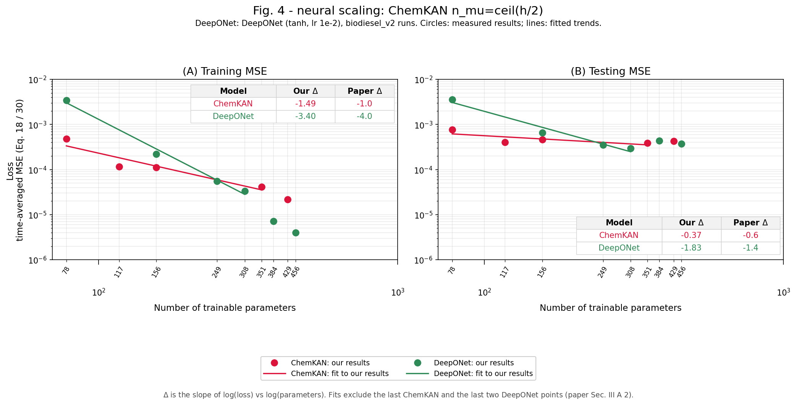
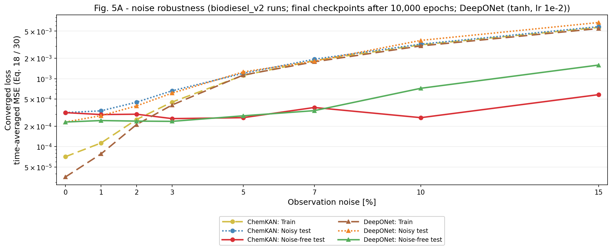
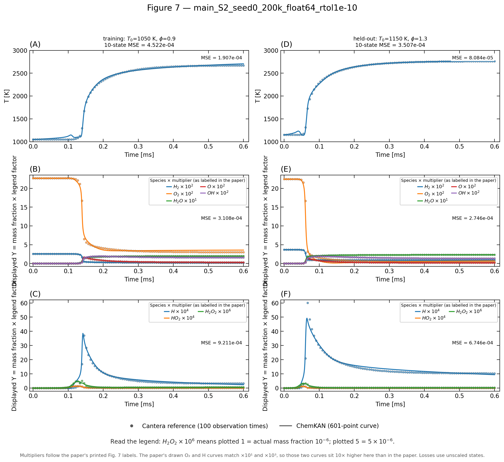
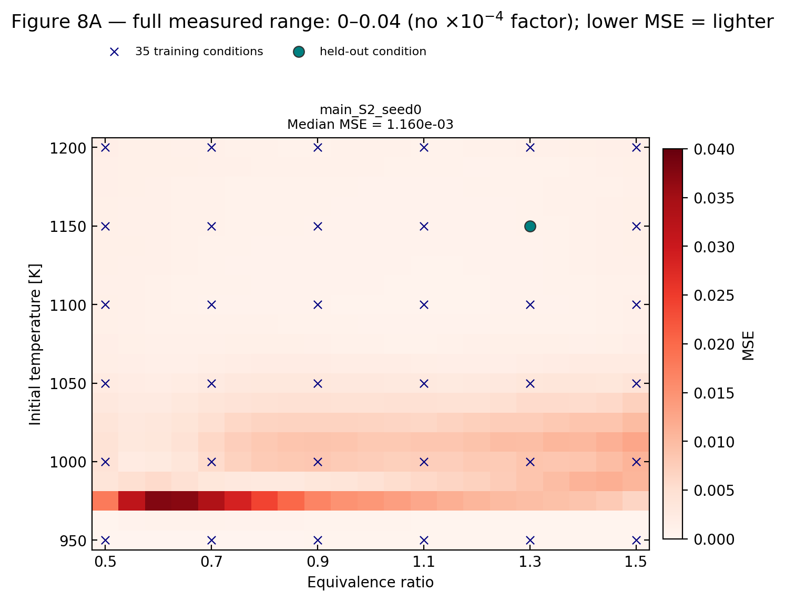
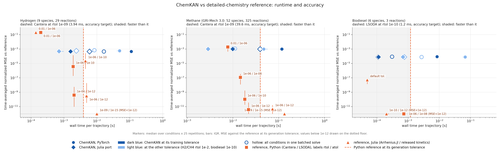
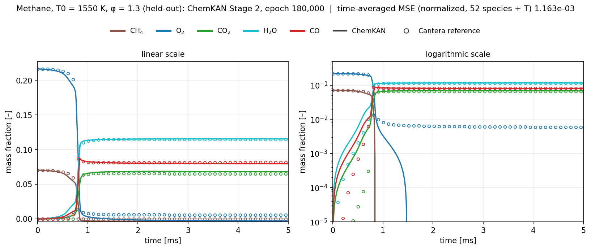
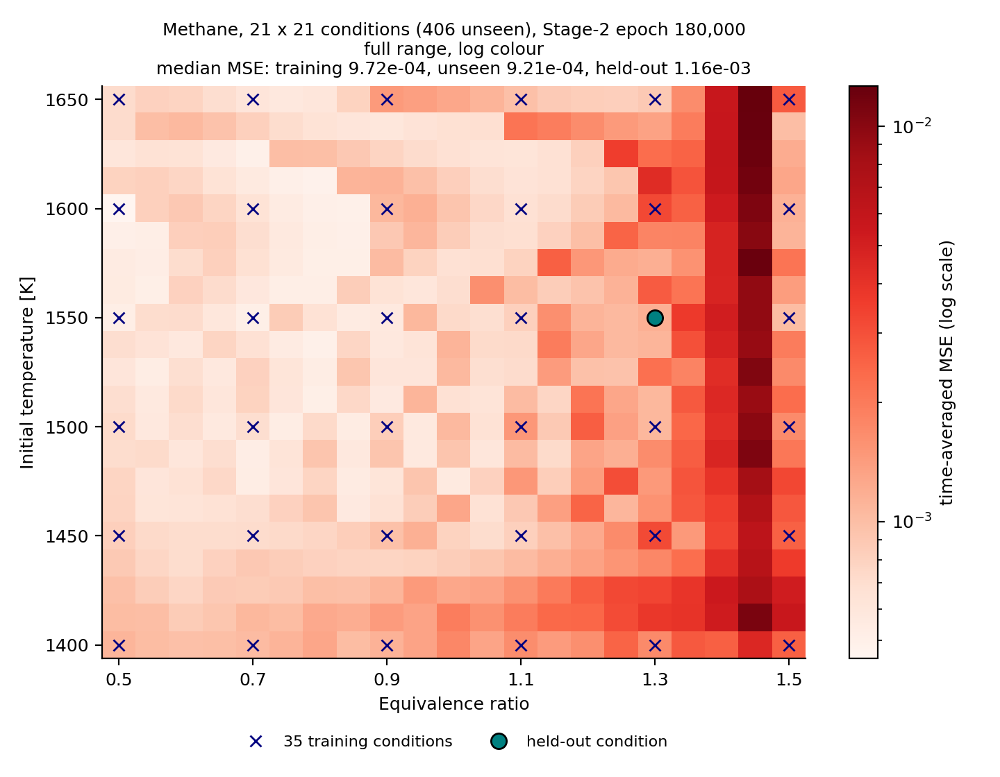

# ChemKAN reproduction: summary

Configurations, numerical results and comparisons for the PyTorch reproduction of
Koenig, Kim & Deng, *ChemKANs for combustion chemistry modeling and acceleration*,
PCCP 27, 17313 (2025) ([local copy](paper/d5cp02009c.pdf)), plus the methane extension.
The sections below link to saved artifacts and display existing release figures.
The main ChemKAN runs use a single seed (seed 0).

**Conventions.** Losses are **time-averaged MSE** in normalized coordinates: the mean over
states and observation times, then over trajectories, as in the authors' released code. The
paper's Eq. 18 sums over the time points instead, so Eq. 18 = N_t × the values here
(N_t = 30 for biodiesel, 100 for hydrogen and methane). The paper does not say which of the two
its plotted losses use, so absolute values are compared as magnitudes only. "Test" is the
noise-free (clean) test MSE unless stated.

## 1. Paper and project results

| Published claim or configuration | Recorded project result |
|---|---|
| Biodiesel model: 156 parameters (7 → 4 → 6, three-point grids, n_μ = 2) | 156 |
| Hydrogen model: 344 parameters, one network, 9 species + T | 344 |
| Fig. 3: ChemKAN reconstructs the unseen condition at 0–15 % noise | clean MSE 8.1e-5 (0 %), 7.0e-5 (5 %), 1.5e-4 (10 %), 3.4e-4 (15 %) |
| Fig. 4: ChemKAN scaling order 1.0 (train) / 0.6 (test) | 1.49 / 0.37 |
| Fig. 4: DeepONet test loss rises past 308 parameters; ChemKAN's plateaus | DeepONet 2.97e-4 at 308, 4.39e-4 / 3.70e-4 at 384 / 456; ChemKAN 3.8–4.7e-4 from 117 to 429 |
| Fig. 5A: training-MSE increase 0 → 1 % noise 3.78e-5; 0 → 5 % 9.64e-4 | 4.19e-5; 1.05e-3 (noise floor 4.46e-5; 1.08e-3) |
| Fig. 5A: noise-free test MSE, 15 % / 0 %: ChemKAN ~2×, DeepONet ~5× | 1.84×, 6.90× |
| Fig. 5A: at 15 %, DeepONet's noise-free test MSE 4.4× ChemKAN's | 2.73× |
| Fig. 5A: ChemKAN has the lower test error at every noise level | lower at 5, 10, 15 %; higher at 0, 1, 2, 3, 7 % (noisy test) |
| Fig. 5A: ChemKAN has the lower training error at 7 % noise and above | DeepONet slightly lower at 7, 10, 15 % |
| Fig. 6: at 15 % noise, ChemKAN tracks the hidden truth more smoothly than DeepONet | noise-free MSE at the Fig. 3 condition: ChemKAN 3.4e-4, DeepONet 7.3e-4 |
| Fig. 7: accurate reconstruction at 1050 K / φ 0.9 (training) and 1150 K / φ 1.3 (held out) | MSE 4.5e-4 and 3.5e-4 |
| Fig. 8A: errors in the 1e-4 range at the 1000 K training points, 1e-3 at the unseen 987.5 K points; weaker below 1000 K | median 4.9e-4 over 441 conditions; 2.1e-3 at 1000 K, 3.5e-2 at 987.5 K |
| Fig. 8B: accurate ignition delays on the 30 igniting conditions | median relative error 1.4 %, max 8.7 % |
| Table I: 2.0× faster than detailed chemistry (Arrhenius.jl) | Julia port 6.3× vs Arrhenius.jl, 2.5× vs Cantera; PyTorch ChemKAN slower than both; different benchmark settings (see §6) |

## 2. Implementation and numerical checks

Checks recorded separately from the paper comparisons:

| Check | Result | Artifact |
|---|---|---|
| Biodiesel right-hand side vs the authors' released Julia code, 60 probe states | relative L2 difference 6e-16 | [`results/biodiesel/equivalence/equivalence.json`](../results/biodiesel/equivalence/equivalence.json) |
| The released example's trained Julia weights in our solver (rtol 1e-2) | train / validation MSE 7.2e-5 / 1.8e-4 vs Julia's 5.0e-5 / 2.1e-4 | same file |
| `train.py` vs `train_biodiesel.py` on the biodiesel data | identical weights | `chemkan/tests/test_train_example.py` |
| FSA gradients vs direct autograd on the final models | converge as the tolerance tightens, to 2e-7 – 4e-6 at rtol 1e-10 | [`forward_sensitivity_analysis.ipynb`](../chemkan/notebooks/forward_sensitivity_analysis.ipynb) |
| Datasets | `biodiesel_v2.npz` and `hydrogen.npz` regenerate with every array identical | [`data_generation_walkthrough.ipynb`](../chemkan/scripts/data_gen/data_generation_walkthrough.ipynb) |
| Resume | a killed and resumed run is bit-identical to an uninterrupted one | release audit |
| Rerunning the recorded runs | the first 5 epochs of all 31 main runs match their histories: exactly for the runs trained on the Mac, to 1e-12 – 1e-16 (float64) for those trained on the JupyterHub | release audit |
| Test suite | recorded release audit: 260 tests passed | `chemkan/tests/` |

## 3. Biodiesel (paper Sec. III A)

**Setup.** `chemkan/data/generated/biodiesel_v2.npz`, generated with the released example's
rate constants and its 30 initial conditions (rows 1–20 training, 21–30 test), 30 points over
30 s, additive noise scaled by each species' maximum (the authors' clarification). Model and
training as the released example: 7 → H → 6 kinetic core, Glorot-uniform weights, dynamics in
normalized coordinates divided by 50 s, Adam lr 1e-2, Tsit5 rtol 1e-2 / atol 1e-6, FSA
gradients, one batched solve. 10,000 epochs (Fig. 5) and 5,000 (Fig. 4). Final losses are
evaluated with a tight solver (rtol 1e-10). Runs:
[`results/biodiesel/chemkan_figure_runs/`](../results/biodiesel/chemkan_figure_runs),
figures: [`results/biodiesel/figures/`](../results/biodiesel/figures), comparison table:
[`biodiesel_reproduction.ipynb`](../chemkan/notebooks/biodiesel_reproduction.ipynb).

**Fig. 4, neural scaling (noise-free).** Final-checkpoint MSE:

| Parameters | ChemKAN train | ChemKAN test | DeepONet train | DeepONet test |
|---|---|---|---|---|
| 78 | 4.79e-4 | 7.68e-4 | 3.45e-3 | 3.55e-3 |
| 117 / 156 | 1.17e-4 / 1.12e-4 | 4.01e-4 / 4.65e-4 | – / 2.22e-4 | – / 6.52e-4 |
| 249 / 308 | – | – | 5.59e-5 / 3.32e-5 | 3.52e-4 / 2.97e-4 |
| 351 / 384 | 4.10e-5 / – | 3.85e-4 / – | – / 7.10e-6 | – / 4.39e-4 |
| 429 / 456 | 2.16e-5 / – | 4.31e-4 / – | – / 4.02e-6 | – / 3.70e-4 |

The fitted orders (log-log least squares, H = 2–9) are 1.49 (train) and 0.37 (test), against the
paper's 1.0 and 0.6. The paper's statement that the ChemKAN error is about 1e-4 already at the
smallest size compares with our 4.8e-4 (train) and 7.7e-4 (test) at 78 parameters.

**Fig. 5A, noise robustness.** Final-checkpoint losses after 10,000 epochs:

| Noise | ChemKAN train | ChemKAN noisy test | ChemKAN clean test | DeepONet train | DeepONet noisy test | DeepONet clean test |
|---|---|---|---|---|---|---|
| 0 % | 7.11e-5 | 3.17e-4 | 3.17e-4 | 3.58e-5 | 2.30e-4 | 2.30e-4 |
| 1 % | 1.13e-4 | 3.36e-4 | 2.96e-4 | 7.80e-5 | 2.85e-4 | 2.42e-4 |
| 2 % | 2.51e-4 | 4.51e-4 | 3.00e-4 | 2.11e-4 | 3.97e-4 | 2.37e-4 |
| 3 % | 4.52e-4 | 6.63e-4 | 2.58e-4 | 4.10e-4 | 6.13e-4 | 2.35e-4 |
| 5 % | 1.12e-3 | 1.20e-3 | 2.67e-4 | 1.13e-3 | 1.26e-3 | 2.84e-4 |
| 7 % | 1.84e-3 | 1.93e-3 | 3.77e-4 | 1.77e-3 | 1.81e-3 | 3.38e-4 |
| 10 % | 3.15e-3 | 3.22e-3 | 2.67e-4 | 3.03e-3 | 3.66e-3 | 7.22e-4 |
| 15 % | 5.68e-3 | 5.83e-3 | 5.82e-4 | 5.47e-3 | 6.71e-3 | 1.59e-3 |

The training-loss increase follows the noise, as in the paper: 4.19e-5 from 0 to 1 % and
1.05e-3 from 0 to 5 %, close to the noise floor (the MSE between the noisy and clean training
targets, 4.46e-5 and 1.08e-3), which is the increase a perfect model would show. ChemKAN's clean
test MSE rises 1.84× from 0 to 15 %, DeepONet's 6.90×. The paper's claims that ChemKAN has the
lower test error at every noise level and the lower training error from 7 % up are not seen:
up to 7 %, ChemKAN's clean test MSE is 0.94× to 1.38× DeepONet's, and it is clearly lower only
at 10 and 15 % (0.37×).

**Figs. 3 and 6.** At the paper's unseen Fig. 3 condition (TG 1.94, ROH 1.43, T 334.75 K) the
clean MSE of the ChemKAN prediction is 8.1e-5, 7.0e-5, 1.5e-4 and 3.4e-4 for the models trained
at 0, 5, 10 and 15 % noise; at 15 %, DeepONet's is 7.3e-4 (Fig. 6). With the training tolerance
(rtol 1e-2) instead of the tight evaluation, the 10 % and 15 % predictions at that condition
carry integration error (2.6e-3 and 6.9e-4):
[`results/biodiesel/notes/tolerance_sweep_REPORT.md`](../results/biodiesel/notes/tolerance_sweep_REPORT.md).

**Reaction order.** The paper's text lists the rate constants of reactions 2 and 3 in the
opposite order to the released code. Training on data generated with each (10,000 epochs,
noise-free) gives final training MSE 5.8e-5 (released order) and 4.8e-5 (paper order), test
2.6e-4 and 3.3e-4: [`results/biodiesel/reaction_order/`](../results/biodiesel/reaction_order).
All other results use the released order.

## 4. DeepONet baseline

Our own PyTorch implementation ([`deeponet/`](../deeponet/README.md)): branch [TG₀, ROH₀, T₀]
→ 8 → 8 → 8, trunk t → 7 → 8, linear head to 6 species; 308 parameters at width 8, the
paper's count. Truncated Glorot-normal weights with zero biases (the reference DeepONet code's
convention), author-global normalized states, mean-MSE objective. The paper
states neither the activation nor the learning rate. A 10-seed comparison chose tanh with Adam
lr 1e-2: median final training MSE 2.4e-3 with ReLU, 8.9e-5 with tanh at lr 1e-3, 3.3e-5 with
tanh at lr 1e-2 ([`results/biodiesel/notes/`](../results/biodiesel/notes)). 14 runs:
[`results/biodiesel/deeponet_figure_runs/`](../results/biodiesel/deeponet_figure_runs).

## 5. Hydrogen (paper Sec. III B)

**Setup.** `chemkan/data/generated/hydrogen.npz`: Cantera with the `h2o2.yaml` mechanism, 1 atm,
36 conditions (T₀ 950–1200 K, φ 0.5–1.5), 35 for training and 1150 K / φ 1.3 held out, 100
points over 0.6 ms (the authors' clarification). 344-parameter ChemKAN with the released code's
KAN conventions; Adam lr 2e-3; Tsit5 rtol 1e-6 / atol 1e-8, float32, one batched solve; direct
autograd; dynamics divided by t_ref = 0.6 ms; element-conservation term 1e-4. Stage 1 (species,
dense observed temperature as input) 100,000 epochs; Stage 2 (full state) from the Stage-1
archive, 100,000 epochs, continued to 150,000 and 200,000. Runs:
[`results/hydrogen/`](../results/hydrogen/README.md); notebook:
[`hydrogen_reproduction.ipynb`](../chemkan/notebooks/hydrogen_reproduction.ipynb).

**Training losses** (time-averaged; last epoch and median over the last 1,000 epochs):

| Stage | Epochs | Last epoch | Median, last 1,000 |
|---|---|---|---|
| Stage 1 | 100,000 | 9.98e-3 | 6.49e-3 |
| Stage 2 | 100,000 | – | 1.93e-3 |
| Stage 2 | 150,000 | – | 7.43e-4 |
| Stage 2 | 200,000 | 6.36e-4 | 6.09e-4 |

**Evaluation of the Stage-2 models**, each integrated from the initial states alone
([`results/hydrogen/eval/`](../results/hydrogen/eval)):

| Model | Median MSE, 35 training conditions | Held-out MSE | Ignition-delay error, median (30 conditions) |
|---|---|---|---|
| 100k | 1.16e-3 | 8.17e-4 | 3.7 % |
| 150k | 5.52e-4 | 4.53e-4 | 1.6 % |
| 200k | 4.75e-4 | 3.51e-4 | 1.4 % (max 8.7 %) |

**Fig. 7** (200k): MSE 4.5e-4 at 1050 K / φ 0.9 and 3.5e-4 at the held-out 1150 K / φ 1.3. The
paper's printed multipliers for O₂ (×10²) and H (×10⁴) do not match its drawn curves, which
correspond to ×10¹ and ×10³; our figure uses the printed labels and says so
([`fig07_hydrogen_trajectories.py`](../chemkan/scripts/figures/fig07_hydrogen_trajectories.py)).

**Fig. 8A** (200k, 441 conditions on a 21 × 21 grid, `hydrogen_fine.npz`): median MSE 4.9e-4,
no integration failures. By initial temperature, the median is 3e-4 to 1e-3 from 1012.5 K up,
2.1e-3 at 1000 K, 3–5e-2 at 975 and 987.5 K and 5e-5 at 950 K (no ignition in the window). The
paper shows the same weakness below 1000 K, with values in the 1e-4 range at the 1000 K
training points and 1e-3 at 987.5 K; ours are higher there. Since the paper does not state its
loss convention for this figure, this is a magnitude comparison.
Tables: [`results/hydrogen/tables/`](../results/hydrogen/tables).

**Fig. 8B** (200k): on the paper's 30 igniting conditions, median relative ignition-delay error
1.4 % (max 8.7 %), median temperature rise 1605 K against the reference's 1581 K. At 950 K, where
the reference does not ignite, the model rises by 7.4 K and 3.6 K at φ 0.7 and 0.9 and not at
the other four.

## 6. Inference speed

[`results/inference_benchmark/`](../results/inference_benchmark/README.md), one Apple M1 thread,
36 conditions, references at the data's generation tolerance (rtol 1e-9):

| System | ChemKAN implementation | Latency per trajectory | vs Cantera | vs Arrhenius.jl | MSE |
|---|---|---|---|---|---|
| hydrogen | Julia port, rtol 1e-6 | 1.60 ms | 2.5× faster | 6.3× faster | 4.6e-4 |
| hydrogen | PyTorch, rtol 1e-6 | 112 ms | 28× slower | 11× slower | 4.6e-4 |
| methane | Julia port, rtol 1e-6 | 9.9 ms | 4.0× faster | 13.5× faster | 9.9e-4 |

The paper's 2.0× (Arrhenius.jl, its own hardware and tolerances) is not directly comparable:
the result depends on the implementation, the tolerances and the timing scope. For biodiesel
(three reactions), the released kinetics in Julia are faster than ChemKAN at matched tolerance.

## 7. Methane extension (project proposal)

Not in the paper. `chemkan/data/generated/methane.npz`: GRI-Mech 3.0 (52 species + T), 36
conditions (T₀ 1400–1650 K, φ 0.5–1.5), held-out 1550 K / φ 1.3, 100 points over 5 ms. The
hydrogen procedure and settings with t_ref = 5 ms; Stage 1 to 54,790 epochs, Stage 2 from the
epoch-50,000 Stage-1 archive to 200,000 epochs ([`results/methane/`](../results/methane/README.md),
[`methane_extension.ipynb`](../chemkan/notebooks/methane_extension.ipynb)).

- Stage-2 training loss: last epoch 2.54e-3, median over the last 1,000 epochs 1.43e-3, still
  falling (2.01e-3 at 100k, 1.87e-3 at 150k). The final model sits on a loss spike, so the
  epoch-180,000 snapshot is reported (lowest training-condition mean among the snapshots from
  175k; the held-out condition plays no part in the choice).
- Epoch 180,000: training-condition MSE median 9.7e-4 (4.5e-4 to 3.2e-3), held-out 1.16e-3.
  On a 441-condition grid: unseen conditions median 9.2e-4 (max 1.3e-2, in a strip at
  φ ≈ 1.40–1.45), ignition-delay error median 1.4 % (max 7.3 %)
  ([`results/methane/generalization/`](../results/methane/generalization/README.md)).
- At the held-out condition the model predicts slightly negative CH₄ and O₂ after ignition
  (about −3e-3 and −2e-3; reference ~0 and 6e-3):
  [`results/methane/figures/methane_main_species_S2_epoch180000_T1550_phi1p3.png`](../results/methane/figures/methane_main_species_S2_epoch180000_T1550_phi1p3.png).

## 8. Forward sensitivity analysis

`chemkan/src/chemkan/fsa.py` solves the state and its parameter sensitivities in one Tsit5
solve and assembles dL/dθ = Σ_j S(t_j)ᵀ ∂L/∂x(t_j). Validation in
[`forward_sensitivity_analysis.ipynb`](../chemkan/notebooks/forward_sensitivity_analysis.ipynb),
on the committed biodiesel, hydrogen Stage-1 and Stage-2 models:

- analytic problem dy/dt = θy: state, sensitivity and gradient errors fall with the tolerance
  (gradient 1.5e-6 at rtol 1e-6, 2.8e-11 at rtol 1e-12);
- the functional right-hand side equals the trainers' to rounding;
- FSA vs direct autograd: 2.6e-4 (hydrogen Stage 2) and 5.2e-5 (Stage 1) at the hydrogen
  training tolerance, 1.5e-7 to 3.7e-6 at rtol 1e-10, in every parameter group;
- trajectories in a batch are independent (cross-derivatives exactly zero);
- at the biodiesel training tolerance (rtol 1e-2) neither backend's gradient is close to the
  converged one (FSA 1.7, direct autograd 23 relative to it), although the loss is accurate.
  The recorded biodiesel runs trained with FSA at that tolerance, as the released example's
  settings prescribe.

An earlier, more extensive validation on the project's first pipeline (pre-registered
acceptance criteria, finite differences, float32) is kept on the development branch and was
not rerun here.

## 9. Discrepancies, limitations and what was not done

- **Biodiesel scaling** (Fig. 4): orders 1.49 / 0.37 against 1.0 / 0.6.
- **Biodiesel noise comparison** (Fig. 5A): the paper's per-level ordering of ChemKAN and DeepONet
  is not reproduced; the ratios and the noise-induced increase are.
- **Hydrogen cold region**: same spatial pattern as the paper's Fig. 8A, but higher errors at
  1000 K (2.1e-3) and 987.5 K (3.5e-2) than its stated 1e-4 and 1e-3 ranges; the paper's loss
  convention for that figure is not stated.
- **Biodiesel gradients**: at the released example's tolerance the FSA training gradients are
  far from converged (§8).
- **Speed**: the Julia port has lower latency than the detailed-chemistry references under the
  measured settings; the PyTorch ChemKAN has higher latency. These timings use different
  tolerances from the paper's reported 2× comparison.
- **Methane**: not converged; slightly negative CH₄ and O₂ after ignition at the held-out
  condition.
- **Single seed** for every ChemKAN run; the DeepONet configuration was chosen over 10 seeds.
- **Not done**: the ChemNODE baseline named in the project proposal; FSA training of hydrogen or
  methane; repeated seeds.
- The authors' clarifications by email (cited as items G*, B*, H*) are summarized in
  `docs/authors_materials.md` on the development branch.
