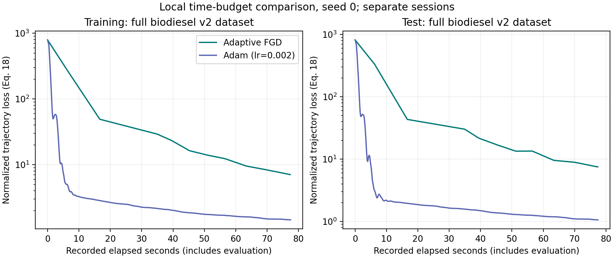
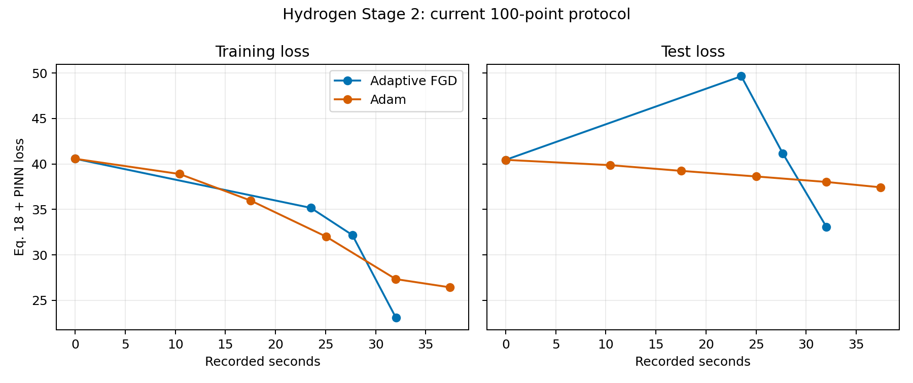
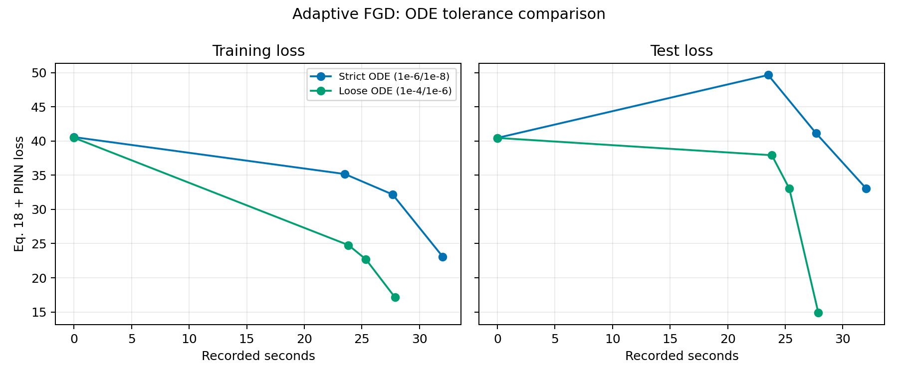
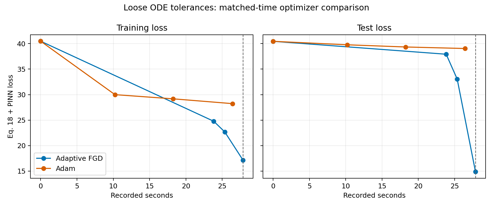
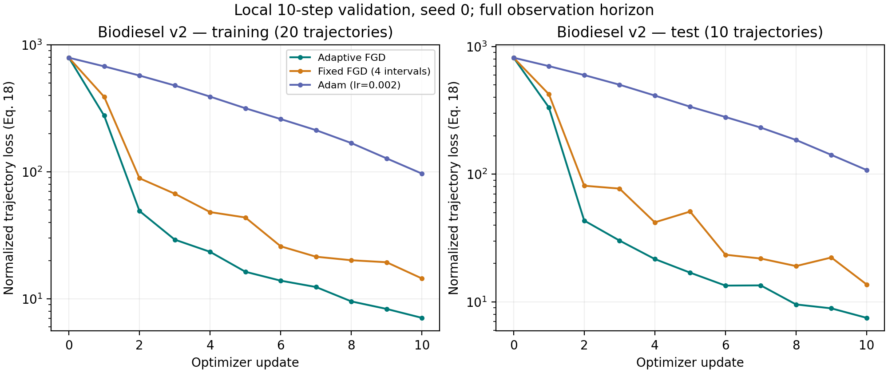

# Local adaptive-FGD validation

Implementation and commands: [`docs/adaptive_fgd.md`](../../../docs/adaptive_fgd.md).
All artifacts in this directory were generated locally, without commits or pushes.

**2026-10-07 implementation note:** new author-matched Hydrogen Stage 2 pilots
capture the same clamped edge coordinates that the additive interpolation actually
evaluates. Earlier author-matched FGD runs captured raw coordinates outside
`[-1,1]`. Their saved numerical results remain historical observations, but a
comparison with the corrected pilots changes the implementation as well as the
learning rate and line-search policy. Standard `tanh` edge coordinates are
unaffected by this correction.

## Completed 100-update pilots with learning rate 0.002

Both new Hydrogen Stage 2 pilots completed all 100 requested updates, starting
from the same current-100-point Stage 1 archive and identical full model weights.
The initial training loss was 40.47694; 0.002 is the starting learning rate,
matching the hydrogen author-matched training script's default, not a loss target.
Both first accepted steps used 0.00025 after backtracking.

Settings: Tsit5 `rtol=1e-4`, `atol=1e-6`; nonmonotone Armijo window 5,
`c1=1e-6`; representation tolerance `epsilon=0.5`. Adaptive FGD starts with
4 interpolation intervals and refines; fixed-grid FGD keeps 256 intervals per
edge. Both calculate functional gradients and use the same line search. The
fixed-grid method is a finite approximation, not an exact kernel expansion.

Final saved checkpoints, reevaluated with stricter `rtol=1e-6`, `atol=1e-8`.
Following the requested reporting correction, the losses below and in the linked
comparison are now averaged over all 100 time points. Both MSE and the conservation
penalty are divided by 100; physical temperature metrics are unchanged. The saved
training histories still record the original summed objective. This conversion
uses existing evaluation results and does not retrain or reevaluate the models.

| Method | Updates | Train loss | Held-out loss | Held-out temperature MAE | Held-out peak temperature rise |
| --- | ---: | ---: | ---: | ---: | ---: |
| Adaptive FGD | 100 | 0.0607203 | 0.0373975 | 461.88 K | 1435.16 K |
| Fixed-grid FGD, 256 intervals | 100 | 0.0491459 | 0.0179088 | 410.15 K | 1466.15 K |

Future runs of `train_adaptive_fgd.py` also optimize the time-averaged objective,
for all three optimizer choices. Its configuration records `loss_reduction` and
rejects resuming old time-summed optimizer histories under the new reduction.
Earlier experiment sections below retain their original time-summed numbers.

The reference held-out temperature rise is 1611.58 K. Both methods now learn
substantial temperature rise, but the plotted ignition behavior and subsequent
heating remain inaccurate. Fixed-grid FGD has lower final train and held-out
loss in this single-seed pilot. Strict reevaluation closely matches the training
solver, so the reported gains are not merely artifacts of its loose tolerances.
The coordinate correction described above prevents attributing the difference
from older runs solely to the learning rate or line search.

All 100 updates in both runs passed the recorded representation certificate
(the fixed-grid method reports it but does not require it). Adaptive and fixed
accepted 22 and 31 temporary training-loss increases, respectively. Neither
stopped early; this does not establish that a longer run would avoid stagnation.
The adaptive run resumed its saved first update after an unusually long trial
solve was interrupted. Subsequent training used a 10,000-RHS-evaluation cap per
solve, allowing expensive trial solves to be rejected and backtracked. Its saved
updates record five such solver trial failures; fixed-grid records none.

Recorded elapsed times were 525.98 seconds adaptive and 727.34 seconds fixed.
They are not a controlled speed comparison: the pilots overlapped, and adaptive's
time excludes the interrupted work after its source checkpoint. No additional
training or automated test suite was run after these pilots; the comparison
evaluates saved checkpoints only. No commits or pushes were made.

[Detailed comparison](hydrogen_stage2_lr002_window5_pilot_comparison/comparison.md)
· [Machine-readable results](hydrogen_stage2_lr002_window5_pilot_comparison/comparison.json)
· [Loss plot](hydrogen_stage2_lr002_window5_pilot_comparison/loss_vs_epochs.png)
· [Temperature plot](hydrogen_stage2_lr002_window5_pilot_comparison/test_temperature.png)

## Earlier implementation validation

Initial implementation validation: **403 tests passed**, including **26 new adaptive-FGD tests**; lint
and formatting checks passed. Existing figure tests emitted Matplotlib/pyparsing
deprecation warnings. All three biodiesel checkpoints and both hydrogen smoke
checkpoints reproduce their recorded train/test losses exactly after reloading.
Details: [`validation.json`](validation.json) and
[`checkpoint_reload_validation.json`](checkpoint_reload_validation.json).

## Adam with the same recorded time budget

Adam was rerun from seed 0 with the same model, data, direct-autograd solver, and
learning rate 0.002, for a **77.345170-second** budget. Its first ten updates
reproduce the earlier Adam loss history exactly. Timing includes the same initial
and per-step train/test evaluations and logging as the original runs.

| Method | Update | Recorded seconds | Train loss | Test loss |
| --- | ---: | ---: | ---: | ---: |
| Adaptive FGD, original run | 10 | 77.345 | 7.075673 | 7.502073 |
| Adam, last complete update within budget | 619 | 77.338 | **1.449345** | **1.062632** |

At this recorded time budget, **Adam has about 7.1 times lower test loss** than
the current adaptive-FGD implementation. It first beats both of FGD's final
losses at update 45, after 5.187 seconds (train 6.840560 / test 7.004731).
Thus the earlier advantage per update does not translate to an advantage per
recorded elapsed time in this experiment.

The runner completes an in-progress update before stopping. Its final saved
checkpoint is update 620 at 77.449 seconds, with train 1.447290 / test 1.060973;
the table conservatively uses update 619 from the recorded history. Reloading the
final checkpoint reproduces both final losses exactly. The checkpoint contains
model/inference state, not Adam's momentum state.

This remains a single-seed comparison across separate sessions. The original FGD
run shared the machine with the test suite; the 77-second Adam run did not. These
are recorded local timings, not an isolated hardware benchmark or a general
ranking of optimizers.

Artifacts: [`biodiesel_adam_77seconds/`](biodiesel_adam_77seconds/), including
[`comparison_with_fgd.json`](biodiesel_adam_77seconds/comparison_with_fgd.json).
The reusable `--max-seconds` option records the last update within the budget.



Export: [`biodiesel_wall_time_comparison.pdf`](biodiesel_wall_time_comparison.pdf).

## Hydrogen Stage 2 on the current 100-point archive

The original 10,000-epoch checkpoint is incompatible with the current dataset. Its
run configuration was created on **2026-08-31**, it first appeared in Git on
**2026-09-05**, and its configuration explicitly records 50 time points. The
hydrogen archive changed to 100 points on **2026-09-29**. Consequently, the earlier
`hydrogen_stage2_adaptive_3steps` / `hydrogen_stage2_adam_57seconds` trial mixed a
50-point Stage-1 model with 100-point Stage-2 data and is superseded. Its artifacts
remain for auditability but are not a valid current-protocol comparison.

The corrected run uses the author-matched Stage-1 archive completed on
**2026-09-30** after 100,000 epochs. Both the archive and current data record the
same SHA-256, 100 time points, and 35 training conditions. The runner also follows
that checkpoint's normalized-coordinate dynamics, time scaling, RBF width,
no-input-`tanh` edges, and seeded thermodynamic initialization. Both optimizer arms
start from the same complete model hash.

| Method | Update used | Recorded seconds | Train loss | Test loss |
| --- | ---: | ---: | ---: | ---: |
| Adaptive FGD | 3 | 32.023 | **23.084406** | **33.069324** |
| Adam, last update within FGD budget | 4 | 32.006 | 27.336752 | 38.021778 |

All three FGD updates passed the representation certificate and Armijo test. In
this short matched-time run, FGD reached 15.6% lower train loss and 13.0% lower
test loss than Adam. Adam's fifth update finished outside the budget at 37.423
seconds and still had higher train/test losses (26.430790 / 37.433739). This is a
single seed and the archive contains only one test condition.

The thermodynamic fit is still poor. FGD's median maximum temperature rise is
14.1 K for training and 10.3 K for test, versus 1,551.8 K and 1,611.6 K in the
references. Adam predicts zero median rise. The corrected run therefore does not
show that either optimizer solves the Stage-2 temperature problem.

Artifacts: [`hydrogen_stage2_current100_adaptive_3steps/`](hydrogen_stage2_current100_adaptive_3steps/),
[`hydrogen_stage2_current100_adam_32seconds/`](hydrogen_stage2_current100_adam_32seconds/),
and [`hydrogen_stage2_current100_comparison.json`](hydrogen_stage2_current100_comparison.json).



Export: [`hydrogen_stage2_current100_wall_time_comparison.pdf`](hydrogen_stage2_current100_wall_time_comparison.pdf).

### Adaptive FGD with looser ODE tolerances

The corrected experiment was repeated with Tsit5 `rtol=1e-4`, `atol=1e-6`
instead of `rtol=1e-6`, `atol=1e-8`. The FGD representation tolerance remained
`epsilon=0.5`, so this isolates the solver-tolerance change.

| FGD solver | Updates | Seconds | Train loss | Test loss |
| --- | ---: | ---: | ---: | ---: |
| Strict `1e-6 / 1e-8` | 3 | 32.023 | 23.084406 | 33.069324 |
| Loose `1e-4 / 1e-6` | 3 | **27.873** | **17.147476** | **14.878213** |

The loose-trained checkpoint was then evaluated with the strict solver. It scored
17.148376 train / 14.878117 test, almost identical to its loose-solver scores.
The gain is therefore present in the learned model rather than being an artifact
of evaluating the final loss inaccurately. The run was also 13.0% faster.

The temperature result is mixed. Training temperature MAE improved from 1,188.6 K
to 1,063.0 K, while test temperature MAE worsened from 1,479.7 K to 1,707.5 K.
The held-out predicted maximum rise increased from 10.3 K to 172.0 K, still far
below the 1,611.6 K reference and apparently with poor timing or trajectory shape.
The lower aggregate test loss therefore comes mainly from the species states.

Looser tolerances change the adaptive solver's evaluation points and consequently
the discretized functional gradient and line-search path. This three-update result
shows a favorable optimization path for this seed; it does not establish that
looser tolerances are generally more accurate or more stable.

Adam was also run from the identical complete model state with the same loose
solver and learning rate 0.002. Under FGD's 27.873-second budget, Adam completed
three updates at 26.435 seconds; its fourth completed outside the budget at 33.178
seconds.

| Loose-solver method | Update | Seconds | Train loss | Test loss |
| --- | ---: | ---: | ---: | ---: |
| Adaptive FGD | 3 | 27.873 | **17.147476** | **14.878213** |
| Adam, last update within budget | 3 | 26.435 | 28.232435 | 39.043247 |

Strict-solver reevaluation gives FGD 17.148376 / 14.878117 and Adam
28.228680 / 39.042770. Thus FGD's strict-rechecked train loss is 39.3% lower
and test loss is 61.9% lower in this short matched-time comparison. FGD also has
lower temperature MAE than loose-solver Adam, but both remain far from the
reference ignition trajectory: FGD predicts a 172.0 K held-out maximum rise and
Adam predicts 0 K, versus 1,611.6 K in the data.

Artifacts: [`hydrogen_stage2_current100_adaptive_looseode_3steps/`](hydrogen_stage2_current100_adaptive_looseode_3steps/)
[`hydrogen_stage2_current100_adam_looseode_28seconds/`](hydrogen_stage2_current100_adam_looseode_28seconds/),
[`hydrogen_stage2_current100_looseode_comparison.json`](hydrogen_stage2_current100_looseode_comparison.json),
and [`hydrogen_stage2_current100_looseode_fgd_vs_adam.json`](hydrogen_stage2_current100_looseode_fgd_vs_adam.json).



Export: [`hydrogen_stage2_current100_fgd_tolerance_comparison.pdf`](hydrogen_stage2_current100_fgd_tolerance_comparison.pdf).



Export: [`hydrogen_stage2_current100_looseode_fgd_vs_adam.pdf`](hydrogen_stage2_current100_looseode_fgd_vs_adam.pdf).

## Complete biodiesel dataset, 10 updates

All three runs use `biodiesel_v2.npz`, seed 0, the same initial 156-parameter
`KineticCore`, float64 computation, Tsit5 (`rtol=1e-6`, `atol=1e-8`), all 20 training
and 10 test trajectories, all 30 observations, and the same normalized Eq. 18
trajectory loss. The initial losses are **791.893636 train / 818.244835 test**.

| Method | Final train loss | Final test loss | Final trainable values | Recorded seconds |
| --- | ---: | ---: | ---: | ---: |
| Adaptive FGD | 7.075673 | 7.502073 | 3380 | 77.35 |
| Fixed FGD, 4 intervals | 14.454665 | 13.703239 | 260 | 62.25 |
| Adam, learning rate 0.002 | 96.803623 | 107.908294 | 156 | 2.65 |

FGD starts from 4 intervals with Gaussian kernel `gamma=100`, tolerance
`epsilon=0.5`, and trial learning rate 0.01 with backtracking. Adaptive FGD ends
at 64 intervals per block; all 10 updates pass the relative-error condition and
decrease training loss. None of the fixed-grid gradients pass that error
condition, although all its accepted updates still decrease the numerical loss.
Both FGD methods keep the original 156 RBF coefficients frozen in addition to
their tabulated trainable values.

This is a short, single-seed validation. Different capacities, gradient geometries,
learning-rate policies, and concurrent test workloads prevent interpreting it as
a controlled speed or final-accuracy benchmark. Adam was much faster in these
runs. Ten updates do not establish asymptotic convergence or generalization
superiority. Hydrogen was only smoke-tested on two trajectories and four early
observations, not trained to combustion/ignition accuracy.



Data: [`comparison.csv`](comparison.csv). Exportable plot:
[`biodiesel_comparison.pdf`](biodiesel_comparison.pdf).

## Run artifacts

- [`biodiesel_full_10steps/`](biodiesel_full_10steps/): adaptive FGD.
- [`biodiesel_fixed_10steps/`](biodiesel_fixed_10steps/): fixed-grid FGD.
- [`biodiesel_adam_10steps/`](biodiesel_adam_10steps/): unchanged RBF model with Adam.

Each includes configuration and dataset hash, per-step diagnostics, CSV history,
metrics, and an inference checkpoint. See the implementation documentation for
checkpoint reconstruction. The ignored `*_smoke/` directories retain the short
biodiesel and hydrogen checks from this session.

To rerun, use the commands in the implementation documentation with new run
directories. The comparison commands differ only in `--method`, `--lr`, and output:

```text
--method adaptive-fgd --steps 10 --lr 0.01
--method fixed-fgd    --steps 10 --lr 0.01
--method adam         --steps 10 --lr 0.002
```
